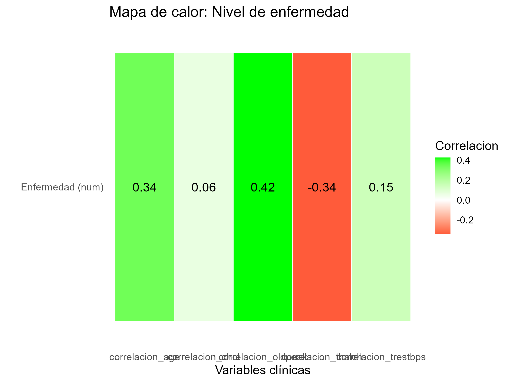
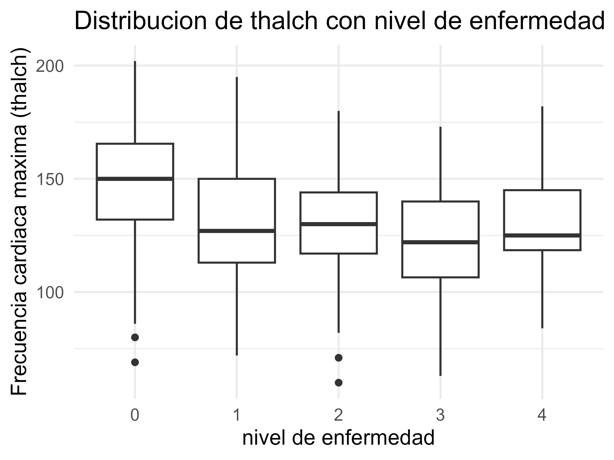
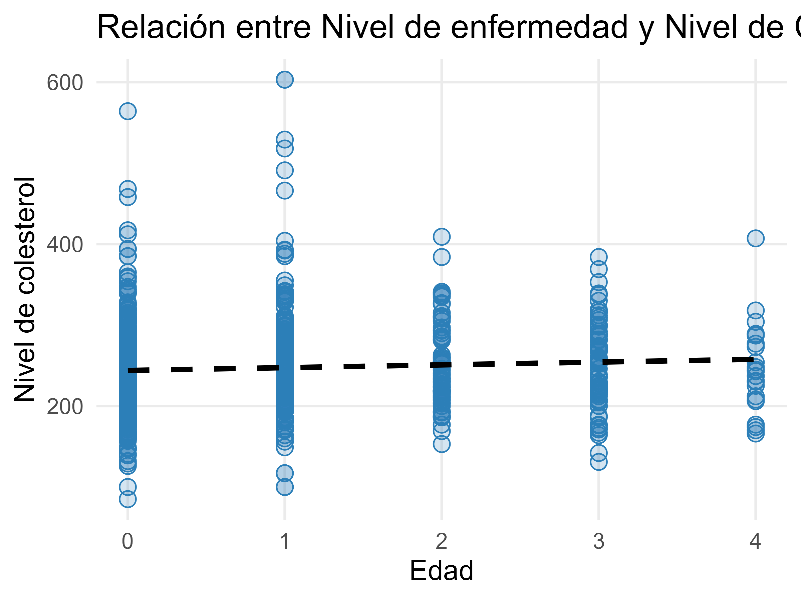

# Análisis exploratorio de enfermedades cardíacas | UCI Heart Disease

Análisis estadístico en R de registros clínicos del conjunto **Heart Disease** del UCI Machine Learning Repository. El trabajo explora calidad de datos, valores faltantes, imputación Hot Deck, estadística descriptiva, asociaciones y visualizaciones.

**English summary:** An exploratory R analysis of the UCI Heart Disease dataset, covering missing-data handling, descriptive statistics, associations, conditional proportions, and visualizations.

## Contenido

- `informe_heart_disease.Rmd`: informe reproducible con el análisis y el código R.
- `data/heart_disease_uci.csv`: conjunto usado en el trabajo (920 filas, 16 columnas).
- `figures/`: gráficos exportados del análisis para consulta rápida.

## Preguntas del análisis

- ¿Cómo describen la media, mediana y dispersión las variables cuantitativas agrupadas por `num`?
- ¿Qué asociaciones exploratorias aparecen entre edad, presión arterial, colesterol, frecuencia cardíaca máxima, oldpeak y `num`?
- ¿Qué proporciones se observan para `num >= 1` entre hombres y entre hombres con dolor de pecho no anginoso?
- ¿Qué muestran los histogramas, diagramas de caja, dispersiones y el mapa de calor?

## Hallazgos en esta muestra

- Hay **920 registros** procedentes de Cleveland, Hungría, Suiza y VA Long Beach. En el archivo analizado, `num` toma valores de 0 a 4.
- La proporción con `num >= 1` es 63,22 % entre los hombres de este archivo. Entre hombres cuyo tipo de dolor es `non-anginal`, es 44,37 %.
- El conjunto tiene valores faltantes y ceros en `trestbps` y `chol`; el informe convierte esos ceros a faltantes antes de aplicar Hot Deck.

Estas son descripciones del conjunto y del tratamiento realizado, no inferencias clínicas. La imputación Hot Deck es una imputación única, por lo que las gráficas y resúmenes no reflejan la incertidumbre entre posibles imputaciones. Las correlaciones con `num` son exploratorias: `num` es una variable ordinal y Pearson no demuestra causalidad.

## Visualizaciones

### Asociación exploratoria de variables con `num`

### Frecuencia cardíaca máxima por nivel `num`

### Colesterol y nivel `num`

## Reproducir

Se requiere R y RStudio o una instalación equivalente de R. Desde la raíz del proyecto:

1. Instala los paquetes que carga el informe: `install.packages(c("dplyr", "ggplot2", "scales", "moments", "writexl", "naniar", "tidyverse", "readr", "VIM", "rmarkdown"))`.
2. Abre `informe_heart_disease.Rmd` y pulsa **Knit**, o ejecuta `rmarkdown::render("informe_heart_disease.Rmd")`.

El informe lee el archivo con la ruta relativa `data/heart_disease_uci.csv`; no depende de una ruta local de Windows.

## Fuente y atribución

Janosi, A., Steinbrunn, W., Pfisterer, M. y Detrano, R. **Heart Disease**. UCI Machine Learning Repository, conjunto 45. [Página del conjunto y documentación](https://archive.ics.uci.edu/dataset/45/heart+disease) · [DOI: 10.24432/C52P4X](https://doi.org/10.24432/C52P4X). UCI indica licencia **CC BY 4.0** para los datos; se atribuye aquí a sus autores y al repositorio.

El código del proyecto no tiene una licencia explícita por ahora.

## Nota de uso

Este análisis tiene fines académicos y de portafolio. No es una herramienta de diagnóstico, no estima riesgo individual y no reemplaza evaluación profesional. Las proporciones observadas dependen de la selección de pacientes y de las decisiones de limpieza e imputación.
